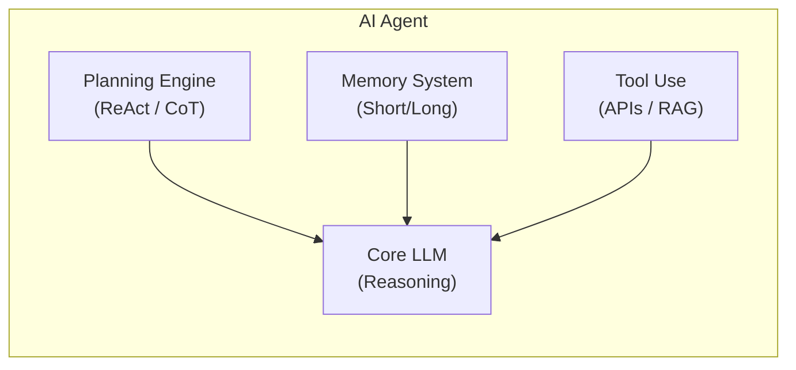
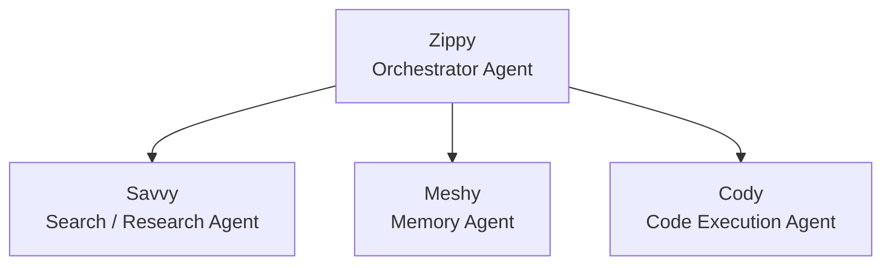

Consolidated reference notes from *AI Agents For Beginners — OpenClaw Case Study* (Mumshad Mannambeth, freeCodeCamp / KodeKloud). Merged from three separate summary passes into a single non-redundant page.

## 1. LLM Fundamentals

### Architecture
- **Transformers & self-attention** — unlike older sequential models, transformers process all words in a sequence simultaneously, using self-attention to weigh how every word relates to every other word.
- **GPT** = *Generative Pre-trained Transformer*: **generative** (produces new text rather than retrieving stored facts), **pre-trained** (learns statistical patterns from a large text corpus before any user interaction), **transformer** (the underlying architecture, introduced by Google in 2017).
- **Next-token prediction** — LLMs don't "know" facts or hold opinions; they learn probabilistic patterns over training text and predict the most likely next token.
- **Training scale** — GPT‑3's training corpus was roughly 125x the size of all of English Wikipedia (~180,000 years of reading at one book/week for a human).

### Limitations
- **Text-in, text-out only** — a raw LLM can't send emails, query databases, or execute code without external tooling.
- **Hallucination** — when uncertain, models tend to produce confident, plausible-sounding text rather than admitting ignorance.
- **Static knowledge** — knowledge is frozen at the training cutoff date.
- **Weak at deterministic tasks** — good at nuanced language work (summarization, translation, code writing), weaker at precise math/logic.

### Tokens, Context, and Cost
- **Tokenization** varies by model family — the same text splits into different token counts across GPT‑4, Llama 3, etc.
- **Context windows** range widely, from ~4k–8k tokens (GPT‑3.5-era models) up to multi-million-token windows (e.g., Gemini 1.5 Pro at ~1M, Gemini "Scout" cited at ~10M). Exceeding the window causes a hard cutoff.
- **Statelessness** — LLM APIs are stateless; every request must resend the full system prompt, prior user/assistant turns, and tool results to preserve context. Cost and latency scale with cumulative conversation length.
- **Pricing example** — GPT‑4-class pricing was cited around $2.50/million input tokens and $10/million output tokens (output costs more since generation is sequential).

### Sampling & Temperature
| Temperature | Behavior | Typical use |
|---|---|---|
| 0.0 – 0.2 | Deterministic, reproducible | Structured extraction, JSON parsing, classification, coding |
| 0.7 – 1.5 | Diverse, less predictable | Creative writing, brainstorming, varied conversation |

## 2. From LLM to Agent

### The Five Core Components of an Agent
| Component | Role | Example |
|---|---|---|
| **Model** | Reasoning engine | GPT‑4 |
| **Tools** | External functions for real-world actions | Calendar check, code execution, web search |
| **Memory** | Stores conversation, tool outputs, system prompt | Sliding window, summarizer, vector store |
| **System Prompt** | Defines personality, rules, available tools, expected behavior | "Be concise, use tools" |
| **Orchestration Loop** | Runs perceive → reason → act cycle, handles tool calls, updates memory | `while` loop driving repeated API calls |

### Workflows vs. Agents
- **Workflows (deterministic)** — the developer hard-codes the step order; the LLM powers individual steps but does not control the flow.
- **Agents (nondeterministic)** — the LLM dynamically evaluates state, chooses which tool to call, inspects results, and decides when the task is complete. Runs a perceive → reason → act loop.
- These sit on a continuum — most production systems mix both.

**When to use which:**
- Can every path be predefined and is the task well-understood/repeatable? → **Workflow**
- Is the task open-ended, context-dependent, or does it need flexible decision-making? → **Agent**
- Is tight cost control critical? → prefer workflow or add strict guardrails to an agent.

## 3. Tool Calling & the Agentic Execution Loop

1. **Schema declaration** — tools are passed to the API as JSON schemas defining function name, description, and parameters.
2. **Function selection** — instead of directly executing anything, the LLM stops generation and returns a structured `tool_calls` payload naming the function and arguments.
3. **Local execution** — the host application parses the call and runs the matching local function/API, capturing the result.
4. **Loop return** — the result is appended back into the message array under a `tool` role and sent back to the LLM to continue reasoning or produce the final response.

This is often called **function calling**, and it's the foundation that turns a plain LLM into an agent.

## 4. Planning & Reasoning — the ReAct Pattern

Agents commonly follow **ReAct** (Reason + Act, sometimes described as Thought → Action → Observation → repeat):
1. **Thought** — evaluate current state and decide what to do.
2. **Action** — invoke a tool.
3. **Observation** — analyze the tool's output.
4. Repeat until the task is complete.

**Guardrails against common failure modes** (infinite loops, stuck plans, wrong assumptions):
- Maximum iteration caps
- Token budget limits
- Structured outputs plus explicit fail-safe instructions

## 5. Memory Architecture

### Short-Term (Context) Memory
Lives inside the active context window; strategies to manage it as it fills up:
- **Truncation** — drop the oldest messages (lossy).
- **Summarization** — compress prior turns into a condensed paragraph using the LLM itself.
- **Context compression / key-value state tracking** — selectively drop or restructure less-important data.

### Long-Term Memory
Offloaded outside the context window into persistent storage, retrieved only when relevant:
- **Vector databases** — semantic embeddings for similarity search over past interactions.
- **Key-value stores** — for durable facts/preferences.
- **Files or relational databases** — general persistent context.

## 6. Multi-Agent Systems

### Orchestration Patterns
- **Router / Orchestrator + Specialists** — a central coordinator evaluates incoming requests and delegates to specialized worker agents (can run in parallel).
- **Pipeline** — agents run sequentially, each refining the previous agent's output.
- **Debate / Adversarial** — agents holding opposing positions collaborate to reach a consensus.

Agents communicate via shared message history, structured handoffs, or shared memory stores — handoffs pass task state and relevant memory rather than the full raw conversation history.

### Worked Example: Zippy, Savvy, Meshy, Cody

- **Zippy** — starts as a basic single-agent, tool-calling assistant (Python + OpenAI SDK) that can check calendars, send emails, and search online. Initially limited by no cross-session memory and no code execution. Evolves into the **orchestrator**, delegating specialized sub-tasks to the other agents.
- **Savvy** — research/web-search specialist; calls external APIs to fetch and extract data, working around the base model's knowledge cutoff.
- **Meshy** — long-term memory specialist; manages state persistence across conversations using vector-store lookups outside the primary context window.
- **Cody** — coding/execution specialist, modeled on production coding-agent patterns (Anthropic/Google style); evaluates source code, plans edits, generates patches, and runs checks in an isolated sandbox. Because it has real side effects, it needs robust error handling and safety controls.

### Error Handling & Self-Correction
When a tool call or code execution fails (non-zero exit, JSON parse error, etc.), the error message is fed back into the prompt so the agent can analyze it and attempt a corrective retry — a simple self-correction loop.

### Guardrails & Human-in-the-Loop
- Deterministic input filtering (e.g., blocking medical/legal advice categories) prevents misuse without spending tokens on an LLM judgment call.
- High-risk actions (e.g., sending an email, executing a destructive command) can be paused for manual human confirmation before execution.

## 7. Advanced Prompt & System-Prompt Engineering

Patterns used in production prompt builders (as seen in OpenClaw):

- **Structural reasoning tags** — forcing step-by-step thinking via rigid tags like `<think>...</think>` before a `<final>...</final>` output, enforcing chain-of-thought by structure rather than instruction.
- **"Before replying" guardrails / step-back prompting** — mandatory pre-response lookup steps baked into the system prompt (e.g., "search memory and check available skills before composing an answer").
- **Few-shot formatting via system prompts** — embedding side-by-side correct-vs-incorrect output examples directly in the system instructions to improve downstream tool-parsing accuracy.
- **Emotional urgency framing** — prompts that signal high stakes tend to elicit more detailed output, matching patterns in the training corpus where urgency correlates with thoroughness.
- **Re-reading (RE2)** — repeating the question/prompt at the end of the message gives a unidirectional decoder model a pseudo-second pass over the key context.

## 8. Case Study: OpenClaw

OpenClaw is the open-source, production-grade agent used to anchor the course's final section.

- **Dynamic prompt builder** — rather than a static prompt string, OpenClaw assembles its system prompt at runtime via a parameter-driven function (`buildAgentSystemPrompt`, ~646 lines of code).
- **Conditional component ingestion:**
  - *Always included:* core identity, tool definitions, base safety guardrails, runtime metadata.
  - *Conditionally included:* specialized skills, user profile/identity, time zone, memory records, workspace files.
- **Takeaway** — at production scale, prompt engineering becomes ordinary software engineering: modular architecture, dynamic templates, and strict state management, rather than a single hand-written prompt.

## Summary Table

| Component | Role | Example |
|---|---|---|
| Model | Brain / reasoning engine | GPT-4 |
| Tools | External functions for real-world actions | Calendar check, code execution |
| Memory | Stores current context, conversation, tool outputs | Sliding window, summarizer, vector DB |
| System Prompt | Agent's personality, constraints, instructions | "Be concise, use tools" |
| Orchestration Loop | Controls the decision cycle and tool handling | `while` loop with repeated API calls |

---

*Source: "AI Agents For Beginners — OpenClaw Case Study," Mumshad Mannambeth / freeCodeCamp & KodeKloud.*
